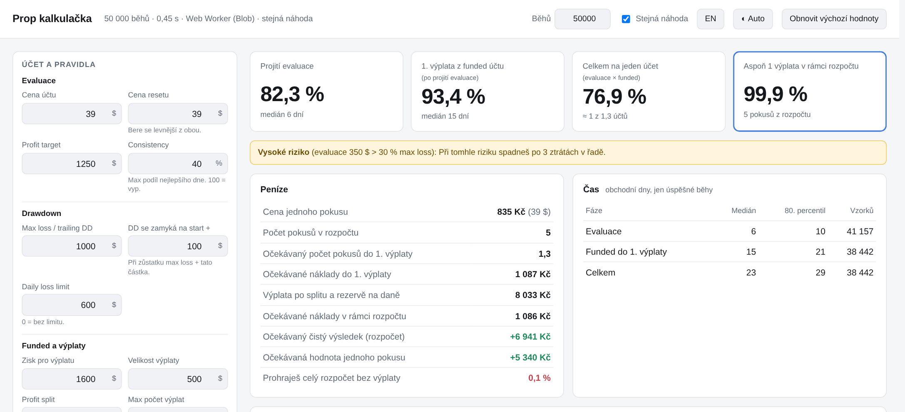
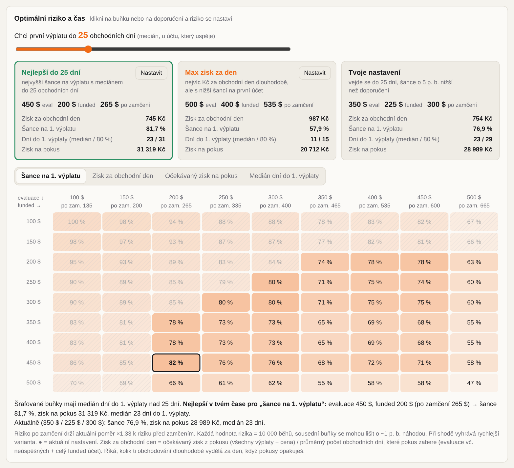
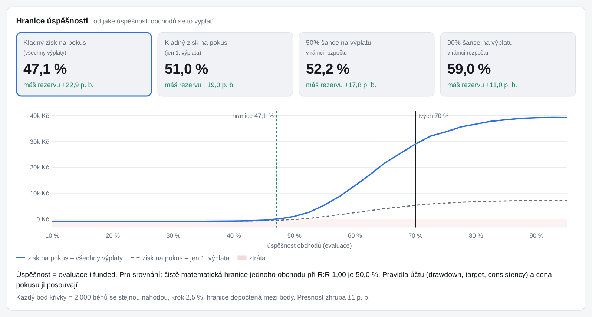
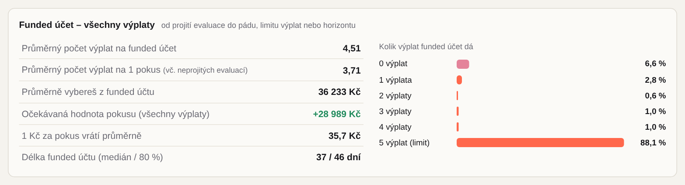
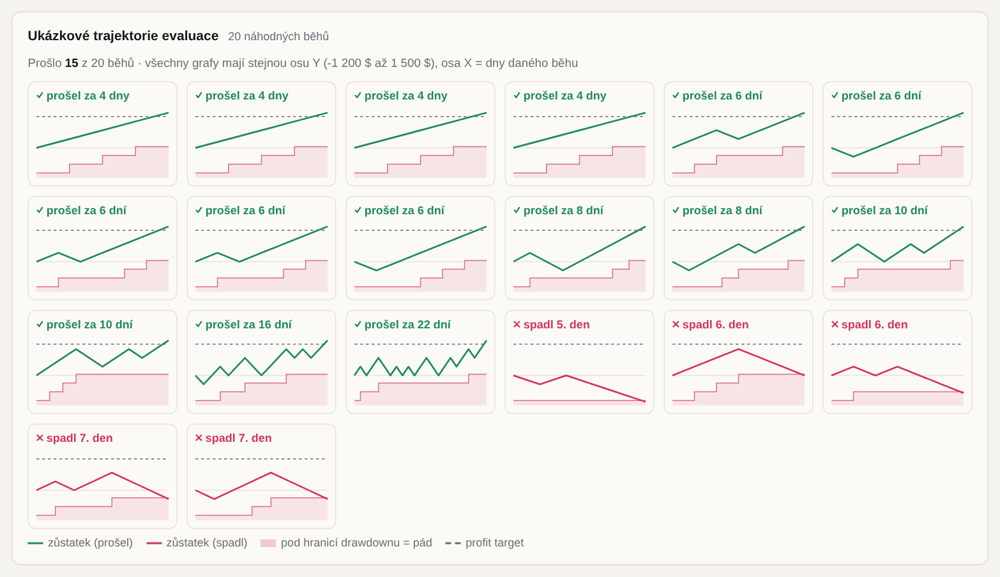
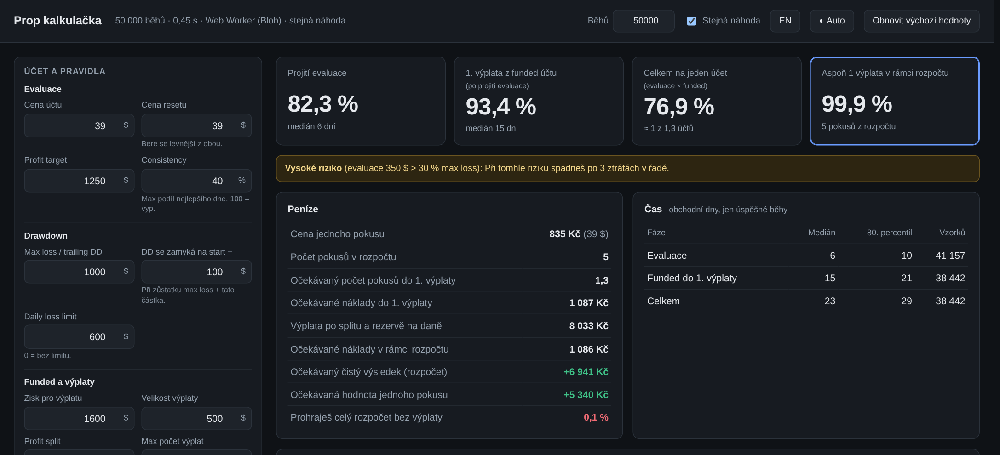
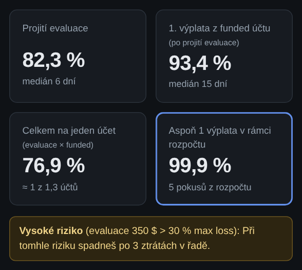

# Prop kalkulačka

Lokální webová kalkulačka pro plánování prop trading účtů: Monte Carlo simulace pravděpodobnosti projití evaluace, výplat z funded účtu a finančního výsledku v rámci rozpočtu. Není to trade journal.



## Jak to vypadá

**Optimální riziko a čas:** slider „chci výplatu do X dní“, doporučené nastavení a heatmapa riziko evaluace × funded.



**Hranice úspěšnosti:** od jaké úspěšnosti obchodů se to vyplatí.



**Funded účet:** kolik výplat průměrně dá a s jakou pravděpodobností.



**Ukázkové trajektorie:** 20 náhodných běhů evaluace s hranicí drawdownu.



**Tmavý režim a mobil:** podle nastavení systému.

<p>
  
  
</p>

## Jak to stáhnout a spustit (krok za krokem)

Nic se neinstaluje. Potřebuješ jen webový prohlížeč (Chrome, Firefox, Edge, Safari…). Pro možnost A ještě [git](https://git-scm.com/downloads); když ho nemáš, použij možnost B.

### Možnost A: přes git

#### 1. Nainstaluj git (jen poprvé)

Nejdřív zjisti, jestli git už nemáš. Otevři terminál:

- **Windows:** stiskni klávesu **Windows**, napiš `PowerShell` a zmáčkni **Enter**.
- **Linux:** stiskni **Ctrl + Alt + T** (nebo v aplikacích najdi „Terminál“).

Do terminálu napiš `git --version` a zmáčkni **Enter**. Když se vypíše něco jako `git version 2.45.0`, git máš a můžeš přeskočit na krok 2.

**Windows**

Varianta 1, příkazem (Windows 10/11): v PowerShellu spusť

```
winget install --id Git.Git -e --source winget
```

Potvrď případné dotazy (napiš `Y` a **Enter**).

Varianta 2, klikáním:

1. Otevři https://git-scm.com/downloads/win a stáhni instalátor (**64-bit Git for Windows Setup**).
2. Spusť stažený soubor `Git-…-64-bit.exe`.
3. Na všech obrazovkách jen klikej **Next** (výchozí volby jsou v pořádku), nakonec **Install** a **Finish**.

Po instalaci **zavři PowerShell a otevři ho znovu** (jinak git nenajde). Ověř příkazem `git --version`.

**Linux**

Podle distribuce spusť v terminálu jeden z příkazů (zeptá se na tvoje heslo, při psaní hesla se nic nezobrazuje, to je v pořádku):

| Distribuce | Příkaz |
| --- | --- |
| Ubuntu, Debian, Linux Mint, Pop!_OS | `sudo apt update && sudo apt install git` |
| Fedora | `sudo dnf install git` |
| Arch, Manjaro, Omarchy | `sudo pacman -S git` |
| openSUSE | `sudo zypper install git` |

Ověř příkazem `git --version`.

#### 2. Stáhni projekt a spusť ho

V terminálu spusť:

```
git clone https://github.com/MatejSulic/prop_firm_calculator.git
cd prop_firm_calculator
```

Projekt se stáhne do složky `prop_firm_calculator` ve složce, kde zrovna jsi (po otevření terminálu je to tvoje domovská složka, na Windows `C:\Users\<tvoje jméno>`).

Pak otevři `index.html` v prohlížeči (pořád ve stejném terminálu):

- **Windows:** `start index.html`
- **macOS:** `open index.html`
- **Linux:** `xdg-open index.html`

Aktualizace na novou verzi: ve složce spusť `git pull` a obnov stránku v prohlížeči (F5).

### Možnost B: stažení jako ZIP (bez gitu)

1. Otevři stránku projektu: https://github.com/MatejSulic/prop_firm_calculator
2. Klikni na zelené tlačítko **`<> Code`** (vpravo nahoře nad seznamem souborů).
3. V menu, které se otevře, klikni úplně dole na **Download ZIP**.
4. Počkej, až se stáhne soubor `prop_firm_calculator-main.zip` (najdeš ho ve složce **Stažené soubory / Downloads**).
5. Soubor rozbal:
   - **Windows:** klikni na ZIP pravým tlačítkem → **Extrahovat vše…** → **Extrahovat**.
   - **macOS:** dvakrát klikni na ZIP, rozbalí se sám.
   - **Linux:** klikni pravým tlačítkem → **Rozbalit sem** (nebo v terminálu `unzip prop_firm_calculator-main.zip`).
6. Otevři rozbalenou složku `prop_firm_calculator-main`.
7. **Dvakrát klikni na soubor `index.html`.** Otevře se v prohlížeči a kalkulačka hned počítá.

Hotovo. Příště stačí znovu dvakrát kliknout na `index.html`.

> Pozor: soubory `index.html` a `sim.js` musí zůstat **ve stejné složce**. Nepřesouvej jen `index.html` jinam, jinak se nic nespočítá.
>
> Když se `index.html` otevře v jiném programu než v prohlížeči (třeba v textovém editoru), klikni na něj pravým tlačítkem → **Otevřít v aplikaci / Otevřít pomocí** → vyber prohlížeč.

### Jak to používat

- Vlevo jsou vstupy (účet, obchodování, peníze). Přepiš libovolné číslo a výsledky vpravo se samy přepočítají (za necelou sekundu).
- Nastavení se ukládá v prohlížeči, takže po zavření a znovuotevření tam zůstane.
- Tlačítko **Obnovit výchozí hodnoty** vrátí všechno na začátek.
- Úplně dole je **Optimální riziko a čas**: posuň slider na počet dní, do kdy chceš výplatu, a klikni na **Nastavit** u doporučení.

## Testy (jen pro vývojáře, běžně nepotřebuješ)

Potřebuješ [Node.js](https://nodejs.org) verze 18 nebo novější. Ve složce projektu spusť:

```
node --test
```

Výpočet běží ve Web Workeru. Při otevření přes `file://` se automaticky spustí přes Blob URL.

## Co umí

- EOD trailing drawdown se zamčením, daily loss limit, consistency pravidlo
- Evaluace a funded fáze s vlastní úspěšností a rizikem (před / po zamčení drawdownu)
- Více výplat z funded účtu (limit výplat, min. dní mezi výplatami, horizont)
- Peníze v libovolné měně (Kč, €, $, £, zł… nebo vlastní): cena pokusu, výplata po splitu a daních, očekávaný zisk
- Čas: medián a 80. percentil dní, histogram, ukázkové trajektorie
- Citlivost na úspěšnost a hranice úspěšnosti (od kdy se to vyplatí)
- Optimalizátor rizika: heatmapa riziko evaluace × funded, slider cílového času
- Presety účtů: Lucid Trading Flex 25K / 50K / 100K (pravidla se vyplní samy)
- Čeština i angličtina (přepínač CZ / EN v hlavičce)
- Vstupy se ukládají do localStorage, světlý i tmavý režim, funguje na mobilu (přepínač Auto / Světlý / Tmavý)

Model předpokládá nezávislé obchody a konstantní úspěšnost, nezahrnuje skluz, poplatky ani psychologii. Není to finanční poradenství.
